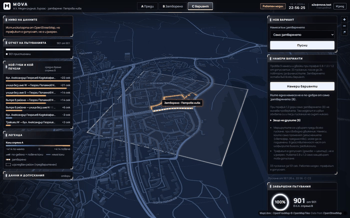
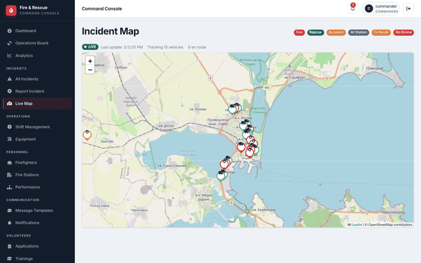
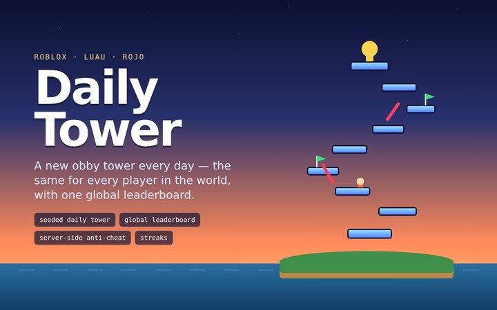
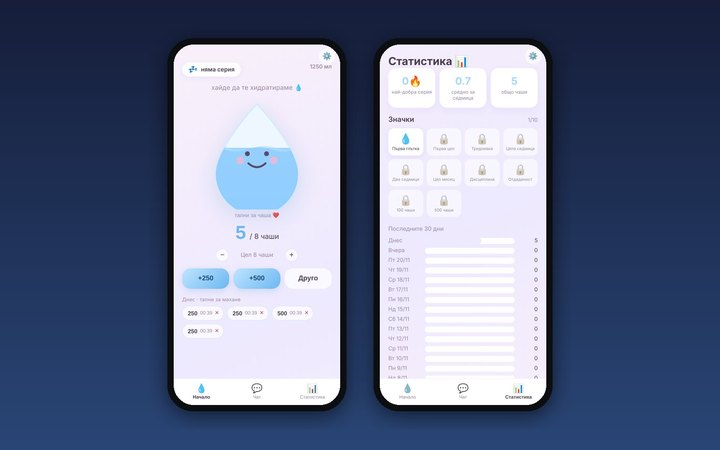
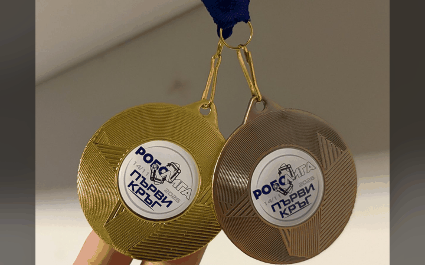

  
<!-- After deploying the portfolio, add:

-->

### 👋 Hi, I'm Valeri

I'm in 11th grade at the **Professional High School of Computer Programming and Innovation** in Burgas, Bulgaria. I build full-stack apps in **Python** and like projects that have to work for real: on a real map, for a real competition or for a real user.

- 🚦 Building **MOVA**, a traffic simulator for real streets, for the John Atanasov IT tournament (Dec 2026)
- 🤖 Robotics club, team **Maze Runners**: 🥇 1st in 3D Labyrinth and 🥉 3rd in Mini Sumo at Robo Liga 2026–27
- 🧠 AI club member, now working on a self-driving car for **IRO Vienna**
- 💼 Open to **junior / intern developer roles**: part-time during school, full-time in summer

---

## 🛠️ What I've built

### 🚦 MOVA — traffic simulation for real streets

What happens to traffic when you close a street? MOVA answers that on the **real map of Meden Rudnik, Burgas**: it simulates the before, the closure and alternatives in SUMO on separate worker machines, compares them, and searches a catalog of small measures for something better — and says honestly when nothing beats the closure.

`Python` `SUMO` `FastAPI` `PostgreSQL` `Docker` `React` `MapLibre` · team of 2 with [@IHNoneva24](https://github.com/IHNoneva24)

<b>▶ How it works &amp; what I built</b>

 

- **Three scenarios:** A = before, B = street closed, C = closure + a measure (traffic lights, priority, turn bans, 30 km/h)
- **Workers:** simulations run as jobs on separate machines, with retries, so the web app stays responsive
- **Variant search:** tries every measure and pair of measures at several traffic levels, re-runs the finalists, and only reports a winner if it really is better
- **Honest data:** the map is real OpenStreetMap; the traffic demand is assumed, and the UI says so

**My part:** the simulation side — the SUMO pipeline, the metrics, the variant search and the worker. Iveta built the UI and API.

🔒 Code goes public after the tournament (4–6 Dec 2026).

### 🚒 Fire & Rescue Command System

A real-time dispatch platform for the Burgas fire service: report an incident on the map, dispatch the nearest unit and watch it drive there **along real roads**.

`Python` `Flask` `SQLAlchemy` `Leaflet` `OSRM` `Chart.js` · solo · Feb–Jun 2026 · [**→ code**](https://github.com/codingburgas/iara-gdbpzn-VATenev23)

<b>▶ Features</b>

 

- **Four roles**, each with its own view: public, firefighter, dispatcher, commander
- **Live routing** on the real road network (OSRM) with vehicles moving on the map
- **Operations board** for the dispatch room: incidents, units, shifts, equipment
- **Commander tools:** analytics, a performance leaderboard from real operational data, major-incident command
- **Firefighter tools:** assigned incidents, status updates, incident chat, SOS button with geolocation
- **Public live map** with a privacy filter at the API boundary, so citizens see incidents without personal data

<table>
<tr>
<td width="50%" valign="top">

### 🗼 Daily Tower

A new Roblox obby tower **every day**, generated from the date so it's identical on every server, with one global leaderboard. Wordle, but it's an obby.

`Luau` `Rojo` · with [@AVGeorgiev23](https://github.com/AVGeorgiev23) · in development

<b>▶ Under the hood</b>

 

- Seeded generation: `Random.new(dayNumber)`
- Server-side timer, in-order checkpoints, anti-cheat
- Streaks, weekday modifiers (low gravity Tuesday, rising lava Wednesday…)
- 36 server services, ~25k lines of strict Luau

**My part:** tower generator, anti-cheat, player data (ProfileStore), shop + Robux purchases, UI framework. **Alex:** leaderboard, streaks, daily rollover. Built with Claude Code writing most of the code; we designed, reviewed and playtested.

</td>
<td width="50%" valign="top">

### 💧 HydroBae

An installable water-tracker app with an **AI chat** that knows how much you've had to drink today. Works offline; built as a birthday gift.

`React` `TypeScript` `Vite` `Vercel` `Claude API` · solo

<b>▶ Under the hood</b>

 

- PWA, tracker fully offline (localStorage)
- Chat goes through a serverless function, so the API key never reaches the browser
- Today's progress is injected into every AI request
- Web Push reminders via Vercel Cron

</td>
</tr>
</table>

---

## 🤖 Robotics

| | Competition | Result |
|---|---|---|
| 🥇 | **Robo Liga 2026–27, round 1** · 3D Labyrinth · TU Varna | **1st place** |
| 🥉 | **Robo Liga 2026–27, round 1** · Mini Sumo · TU Varna | **3rd place** |
| 🚗 | **IRO Vienna** · autonomous driving | building it now |
| 🏁 | **John Atanasov IT tournament** · MOVA | 4–6 Dec 2026 |

<b>▶ The robots</b>

 

- **Mini sumo:** Zumo chassis, Elegoo Uno R3, a 3D-printed front ramp with two HC-SR04 ultrasonic sensors to find the opponent
- **IRO car:** base plate, Elegoo Uno R3 and breadboard; driving now, Raspberry Pi 4 + camera next
- **Workshops (Nov 2026):** programmed a 6-axis Kawasaki cobot in AS; built an Arduino satellite model that makes its own decisions (EnduroSat)

## 📜 Certifications

| Certification | Score | Year |
|---|---|---|
| IT Specialist — JavaScript | 880 / 1000 | 2025 |
| Microsoft Office Specialist — Excel Associate | 775 / 1000 | 2025 |
| IT Specialist — HTML and CSS | 771 / 1000 | 2024 |
| Microsoft Office Specialist — Word Associate | 884 / 1000 | 2024 |
| Goethe-Zertifikat A1 | 51 / 60 · sehr gut | 2026 |

---

<picture>
  <source media="(prefers-color-scheme: dark)" srcset="https://raw.githubusercontent.com/VATenev23/VATenev23/output/snake-dark.svg">
  
</picture>

Most of my code lives in private repos until the competitions are over. Ask me for access: <a href="mailto:tenevv55@gmail.com">tenevv55@gmail.com</a>

